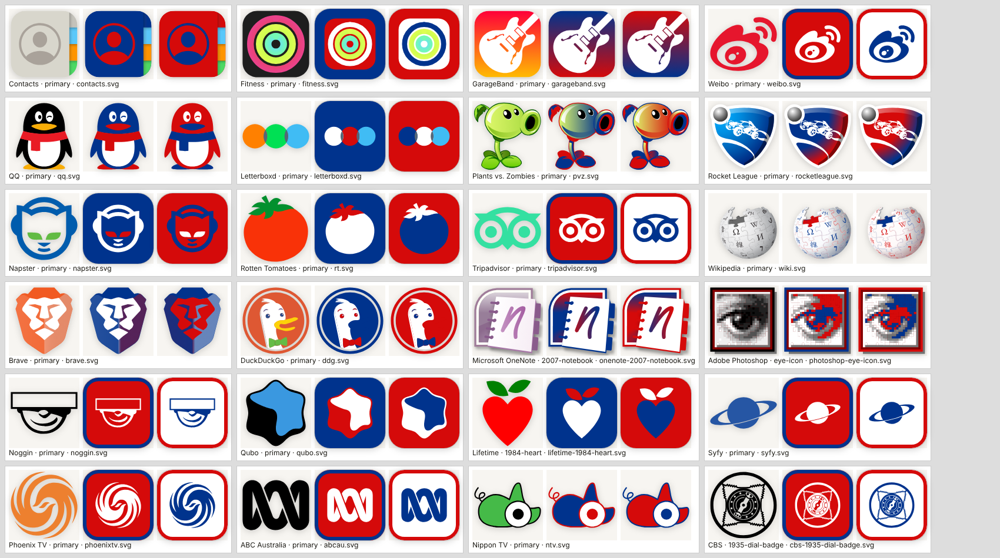

# Apps and TV, second round

Adds 97 entries and 68 alternates: **175 apps, 98 TV channels, 1515 total entries and 816 alternates**.

| Collection | Before | After | Categories (count) |
|---|---|---|---|
| APPS | 112 | 175 | Built-in 35, Social 32, Games 23, Music & Video 27, Everyday 32, Productivity 26 |
| TV | 64 | 98 | Broadcast 12, Cable 16, Music & Pop 5, Kids 13, Discovery & Lifestyle 13, Sports 15, International 24 |

- **New apps (63):** Contacts, Books, Translate, Stocks, Voice Memos, Fitness, News, Keynote, Pages, Numbers, GarageBand, iMovie, Passwords; Nextdoor, Letterboxd, Goodreads, Medium, Substack, Weibo, QQ, Patreon, GroupMe, Vine, Myspace; Plants vs. Zombies, Rocket League, Terraria, Toca Boca, Clash of Clans, Hearthstone; Napster, Kodi, Rotten Tomatoes, Fandango, Audiomack, Bandcamp, IMDb, Anghami; Tripadvisor, Wikipedia, Peloton, Fitbit, Google Classroom, Expedia, Booking.com, Quizlet, Alexa, Google Home, ClassDojo; Google Slides, Translate, Keep and Calendar, OneDrive, OneNote, Microsoft Edge, Brave, DuckDuckGo, Adobe Photoshop, Adobe Acrobat, Grammarly, Visual Studio Code, Canva.
- **New channels (34):** Galavisión, Antenna TV, ION; Lifetime, Freeform, Syfy, Adult Swim, TBS, Bravo; Sprout, Qubo, Noggin; Ovation, Food Network; WWE Network, NESN, Star Sports, GolTV, NHL Network, DAZN, beIN Sports; Das Erste, SBS, KBS, Phoenix TV, ABC Australia, Nippon TV, Canal 13, Telefe, Channel 5, France 2, Canale 5, Antena 3, Zee TV.
- **Alternates:** 50 came with 36 of the new entries (the Peashooter's sunflower and zombie, Rotten Tomatoes' splat and popcorn, Napster's 2022 and 2025 cats, OneNote's 2007 notebook, Photoshop's 2002 eye, Acrobat's 2004 silver tile, Lifetime's 1984 heart, Syfy's 2002 orbit, Noggin's 1999 jar head, France 2's 1975 star, Channel 5's 1997 ring, Canal 13's 1969 mark…), and 18 went to 17 existing entries (the 2007 glossy Messages tile, WeChat's 2011 bubbles, Bard's twin sparkles for Gemini, Outlook's 1997 pixel icon, the 1935 CBS dial badge, Discovery's 1985 map screen, Nick Jr.'s 1988 elephants and 1993 hippos, Telemundo's 1987 ball, Univision's 1976 op-art square…).

## Behavior

- No new categories: every addition sits at the end of its existing category. Existing entries, IDs, artwork and palettes are unchanged; existing entries only gained `alternateLogos`, appended after their current ones (checked field by field against `main`), so saved rounds and Shuffle Logo order load as before.
- Name-visible artwork is flagged `showsName` and sits random logo pools out: IMDb, ION, TBS, Bravo, Food Network, NHL Network, DAZN and beIN Sports. Every other new primary and every alternate is a name-free symbol, mascot, icon, numeral or monogram, and no alternate label contains the answer.
- No new name, short code or alias is an accepted answer for any other catalog entry, and every second palette color is a real brand color (never white).
- Left out on purpose: Disney+ (its name normalizes to Disney, a BRANDS entry), Amazon Music (Amazon's smile), A&E (an answer for American Eagle), Oxygen (the element), Investigation Discovery ("ID" is Indonesia's flag), Kids' WB (the Warner Bros. shield), Nat Geo Wild and Nicktoons (the same marks as National Geographic and Nickelodeon), Band (an eye like CBS's), Eurosport (a star ring like the EU flag), Doordarshan (lettering cut into the symbol), Destination America (an empty banner once its lettering is removed), and Apple's Shop app (the Apple logo).

## Artwork

- All new artwork is checked-in SVG. Each variant's source URL, source page, source SHA-256 and reviewed `brand_vector.py` edits are pinned in `scripts/brand_artwork_sources.json`; output checksums and palette roles are in `apps-manifest.json` and `tv-manifest.json`. Sources: the Logowik iOS 17 sheet, Logopedia, Wikimedia Commons, Iconify sets, worldvectorlogo, iconape and similar.
- Every variant was reviewed on white and dark contact sheets, then rendered with the game's `Logo` component in original colors and in two Buffalo Bills remixes: all 165 originals and 330 remixes reached `ready`, with zero failures and zero page errors.

## Validation

- `npm run logos:apps` and `npm run logos:tv` reuse every checked-in asset offline (a forbidden-fetch check passes), and every brand builder leaves `teams.json` byte-for-byte unchanged.
- Full suite: 204 passed, 1 skipped (the optional Potrace test), 3 failed. All three are time-limit failures in tests these changes don't touch: two high-school tests with 5 s limits pass when rerun with `bun test --timeout 180000`, and the alternates-rebuild test in `team-alternates.test.ts` keeps its own 30 s limit and times out identically on an untouched `main` checkout in this container. The brand, backdrop, collection, dark-plate and color-donor tests all pass. `npm run build` passes with Vite's standard >500 KB bundle advisory.
- Playwright Chromium, 1024×1366 with touch: TV → International shows 24 tiles; Nippon TV's Nandarou picked and remixed in Los Angeles Lakers colors.
- Playwright Chromium, 390×844 with touch, dark mode: APPS → Games shows 23 tiles and TV → Sports shows 15; no page-wide horizontal overflow, no page errors and no failed requests.

Screenshots:

- [TV picker, International, on iPad](tv-picker-ipad.png)
- [Nippon TV in Lakers colors on iPad](nippontv-in-lakers-ipad.png)
- [APPS picker, Games, on phone, dark mode](apps-games-phone-dark.png)
- [TV picker, Sports, on phone, dark mode](tv-sports-phone-dark.png)

The browser checks emulate viewport and touch behavior; they are not tests on physical iOS Safari.
