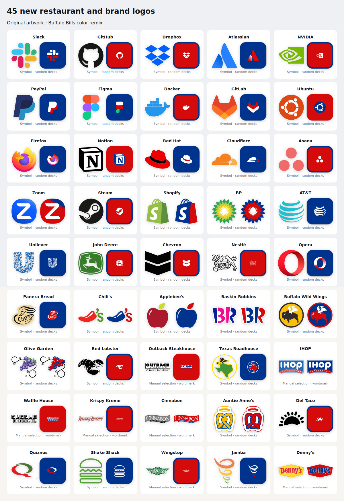
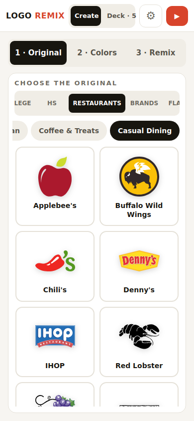
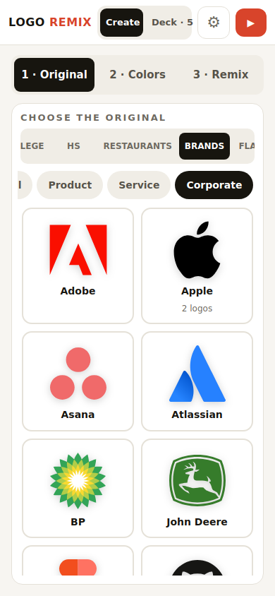
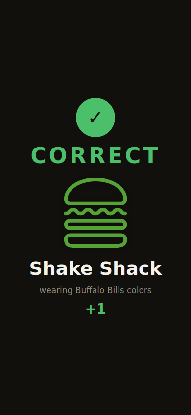

# Restaurants and brands expansion

Adds 20 restaurants and 25 brands to the catalog: **50 restaurants, 60 brands, 931 total entries and 489 existing alternates**.

Restaurants: Panera Bread, Chili's, Applebee's, Baskin-Robbins, Buffalo Wild Wings, Olive Garden, Red Lobster, Outback Steakhouse, Texas Roadhouse, IHOP, Waffle House, Krispy Kreme, Cinnabon, Auntie Anne's, Del Taco, Quiznos, Shake Shack, Wingstop, Jamba and Denny's.

Brands: Slack, GitHub, Dropbox, Atlassian, NVIDIA, PayPal, Figma, Docker, GitLab, Ubuntu, Firefox, Notion, Red Hat, Cloudflare, Asana, Zoom, Steam, Shopify, BP, AT&T, Unilever, John Deere, Chevron, Nestlé and Opera.

## Behavior

- The food collection is labeled **RESTAURANTS**, with a new **Casual Dining** filter. The existing `FOOD` IDs, asset directory and `Fast Food` random-pool ID stay compatible with saved rounds and preferences.
- All new artwork is checked-in SVG. Source URLs, source-page links, source SHA-256 values, reviewed edits, output SHA-256 values and palette roles are recorded in the source file and collection manifests.
- Symbol crops preserve source vector paths. For artwork sharing a path with adjacent lettering, `clipToViewBox` enforces the reviewed crop when an SVG is fitted into a square. It preserves existing definitions/styles and avoids source ID collisions.
- Seven new name-visible restaurant marks (Cinnabon, Denny's, IHOP, Krispy Kreme, Outback, Waffle House and Wingstop) are manually selectable and excluded from random logo pools.
- Existing restaurant/brand records and artwork remain unchanged. NFL, NBA and college remain the only color donors.

## Validation

Production build: passed; Vite retains its bundle-size advisory (127.93 KB gzip).

29 targeted tests passed, zero failures:

```sh
npm exec --yes --package=bun -- bun test tests/brands.test.ts tests/collections.test.ts tests/color-donors.test.ts tests/original-rounds.test.ts
npm exec --yes --package=bun -- bun test tests/highschool.test.ts --test-name-pattern 'the team browser uses|existing NFL and college'
npm exec --yes --package=bun -- bun test tests/backdrop.test.ts --test-name-pattern 'artwork gets a tile exactly'
npm run build
```

Coverage includes complete rosters, all aliases, random-deck eligibility, donor restrictions, exact saved variants, all import checksums/palette roles, offline regeneration, preservation by every roster builder, category controls, and SVG clipping validation including ID collisions and invalid crop options. The full exhaustive suite was not rerun for this expansion.

Chromium 134 browser verification:

- Rendered every new entry with the application's `Logo` component, both original and Buffalo Bills remix; all 45 remixes reached `ready`, all 90 images decoded, zero browser exceptions.
- Reviewed all new artwork side by side, including the explicit crops in square remix tiles.
- At 390 × 844: 50 restaurant entries, 10 Casual Dining entries, 60 brands and 20 Corporate entries; no horizontal page overflow.
- Selected Shake Shack and Buffalo Bills through the picker, added one round, reloaded, started gameplay, and submitted “Shake Shack”: graded **CORRECT**. The stored round retained `FOOD-SHAKE` and `PRO-BUF`.

These are emulated Chromium viewports, not physical iOS Safari tests.

## Screenshots








