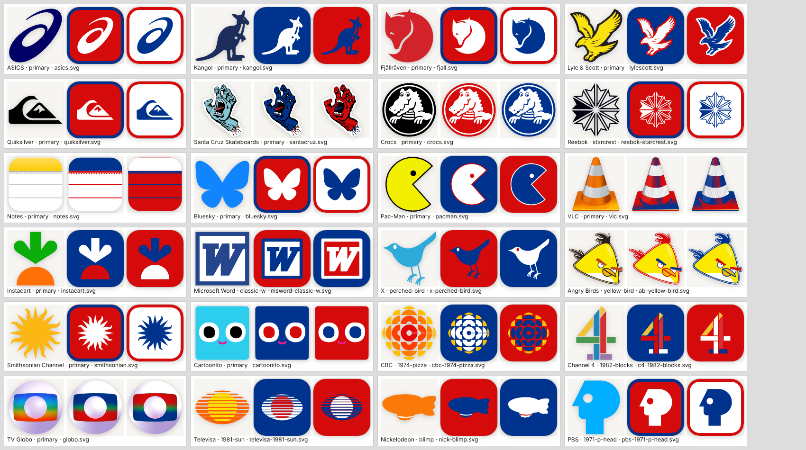

# Clothing, apps and TV expansion

Adds 152 entries and 103 alternates: **117 apps, 64 TV channels, 81 clothing brands, 1,134 total entries and 592 alternates**.

| Collection | Before | After | Categories (count) |
|---|---|---|---|
| APPS | 50 | 117 | Built-in 22, Social 21, Games 20, Music & Video 20, Everyday 22, **Productivity** 12 |
| TV | 30 | 64 | Broadcast 9, Cable 10, Music & Pop 5, Kids 10, Discovery & Lifestyle 11, **Sports** 8, **International** 11 |
| CLOTHING | 30 | 81 | Sportswear 17, Streetwear 11, Outdoor 15, Preppy 12, Everyday 9, **Surf & Skate** 10, **Footwear** 7 |

Alternates now number 61 for apps, 43 for channels and 28 for clothing. 41 went to 34 existing entries (older app icons such as the 2006 Twitter bird and Snapchat's 2011 ghost, four more Angry Birds, Chrome's 2008 orb, PBS's 1971 P-head, the Nickelodeon blimp, Reebok's starcrest, Puma's 1948 Dassler badge, BAPE's Baby Milo…), and 62 came with 50 of the new entries (Microsoft Word, Excel and PowerPoint's 2013 and classic icons, CBC's 1974 exploding pizza and 1966 butterfly, Channel 4's 1982 blocks, older Globo, Televisa and Record TV marks, Le Coq Sportif's red triangle, Quiksilver's 1970 wave…).

## Behavior

- New categories are added at the end of each collection's filter row, so existing filters and saved preferences keep their positions. Hints read "Logo: Productivity app", "Logo: Sports channel", "Logo: International channel", "Logo: Surf & Skate brand" and "Logo: Footwear brand".
- Existing entries, IDs, artwork and palettes are unchanged; existing entries only gained `alternateLogos` (checked field by field against `main`), so saved rounds load as before.
- Name-visible artwork is flagged `showsName` and sits random logo pools out, like the existing wordmark entries: Tetris and Candy Crush Saga; The CW, AMC, FX, Disney XD, TLC, NFL Network, NBA TV, MLB Network, FS1, BBC and Nine Network; H&M, Zara, Uniqlo, Old Navy, UGG and Dr. Martens. Every other new primary and every alternate is a name-free symbol, mascot, icon or monogram, and no alternate label contains the answer.
- Every brand palette's second color is a real brand color, never white, so the team browser never shows two white swatches.
- Left out on purpose: Facebook (already an accepted answer for Meta), Apple TV (its icon spells "tv"), Paramount Network (the same star-ringed mountain as Paramount+, which stays), Sky and Sky Sports ("Sky" is the Chicago Sky), USA Network ("USA" is the US flag), the SEC, ACC and Big Ten networks (their marks are the college conference entries), and MSNBC/CNBC (the NBC peacock).

## Artwork

- All new artwork is checked-in SVG. Each variant's source URL, source page, source SHA-256 and reviewed `brand_vector.py` edits are pinned in `scripts/brand_artwork_sources.json`; output checksums and palette roles are in `apps-manifest.json`, `tv-manifest.json` and `clothing-manifest.json`. Sources: Iconify sets, Wikimedia Commons, Logopedia, Logowik, worldvectorlogo, iconape and similar.
- Wordmarks, taglines, ®/™ marks and page backgrounds are removed with element edits. Where a symbol shares one path with lettering or a neighboring mark (O'Neill, Merrell, Sperry, the Russell R, the Asics stripes, the Hummel chevrons, the Obey face, Brooks' older chevron, Off-White's stripes, the Polo jeans flag, the Wrangler horse tab, the Fortnite llama), `clipToViewBox` enforces the reviewed crop.
- Every variant was reviewed on white and dark contact sheets before merging, then rendered with the game's `Logo` component in original colors and in two Buffalo Bills remixes: 255 originals and 510 remixes all reached `ready`, with zero failures and zero page errors.

## Validation

- `npm run logos:apps|tv|clothing` reuses every checked-in asset offline (a forbidden-fetch check passes), and all eight brand builders leave `teams.json` byte-for-byte unchanged.
- Full suite: 188 passed, 1 skipped (the optional Potrace test), 0 failed. `npm run build` passes with Vite's standard >500 KB bundle advisory.
- Playwright Chromium, 1024×1366 with touch: CLOTHING → Footwear shows 7 tiles; Crocs picked and remixed in Los Angeles Lakers colors.
- Playwright Chromium, 390×844 with touch, dark mode: APPS → Productivity shows 12 tiles and TV → International shows 11 (Sports is next to it); no page-wide horizontal overflow, no page errors and no failed requests.

Screenshots:

- [CLOTHING picker, Footwear, on iPad](clothing-picker-ipad.png)
- [Crocs in Lakers colors on iPad](crocs-in-lakers-ipad.png)
- [APPS picker, Productivity, on phone, dark mode](apps-picker-phone-dark.png)
- [TV picker, International, on phone, dark mode](tv-picker-phone-dark.png)

The browser checks emulate viewport and touch behavior; they are not tests on physical iOS Safari.
