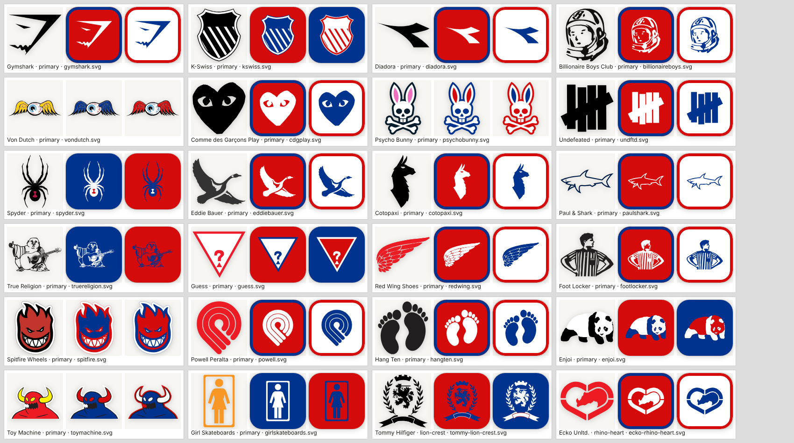

# Clothing, third round

Adds 66 clothing brands and 21 alternates: **147 clothing brands, 1581 total entries and 847 alternates**.

| Category | Before | After | New brands |
|---|---|---|---|
| Sportswear | 17 | 27 | Gymshark, K-Swiss, Sergio Tacchini, Li-Ning, Anta, Diadora, Macron, Castore, Kelme, Yonex |
| Streetwear | 11 | 19 | Billionaire Boys Club, Von Dutch, Comme des Garçons Play, Evisu, Rocawear, Undefeated, Psycho Bunny, Baby Phat |
| Outdoor | 15 | 26 | Spyder, Eddie Bauer, Berghaus, Rossignol, Salewa, Cotopaxi, Haglöfs, Mountain Hardwear, Burton, Dynafit, Vaude |
| Preppy | 12 | 19 | Paul & Shark, Southern Marsh, Jack Wills, Tommy Bahama, North Sails, J.Crew, Gant |
| Everyday | 9 | 17 | True Religion, Bombas, Guess, Dockers, Jordache, Lands' End, Hanes, Lee |
| Surf & Skate | 10 | 23 | RVCA, Etnies, Spitfire Wheels, Powell Peralta, Independent Truck Company, Hang Ten, Emerica, T&C Surf Designs, Enjoi, Toy Machine, Vissla, Girl Skateboards, Thrasher |
| Footwear | 7 | 16 | Red Wing Shoes, Sorel, Heelys, Ariat, Foot Locker, Stride Rite, Airwalk, Payless, Teva |

**Alternates:** 12 came with 11 of the new brands (Billionaire Boys Club's spacewalker and Ice Cream cone head, K-Swiss's 2015 shield, Salewa's soaring eagle, Burton's 2002 B tile, True Religion's horseshoe, Bombas' 2025 bee, Dockers' 2000 wings, Jordache's horse silhouette, Stride Rite's 1972 flower, RVCA's lion crest, Spitfire's crossbones), and 9 went to existing brands (Converse's slashed star, Ecko's rhino heart, Fruit of the Loom's engraved box, Mammut's older mammoth disc, New Balance's block N, Quiksilver's Q, Rip Curl's jagged diamond, Tommy Hilfiger's lion crest, U.S. Polo Assn.'s P shield).

## Behavior

- No new categories; every addition sits at the end of its existing category. Existing entries, IDs, artwork and palettes are unchanged; existing entries only gained `alternateLogos`, appended after their current ones (checked field by field against `main`), so saved rounds and Shuffle Logo order load as before.
- Lee, J.Crew, Gant and Thrasher only publish wordmarks, so they are flagged `showsName` and sit random logo pools out. Every other new primary and every alternate is a name-free symbol, mascot, icon or monogram, and no alternate label contains the answer.
- No new name, short code or alias is an accepted answer for any other catalog entry (Billionaire Boys Club's short code avoids "BBC", T&C Surf Designs avoids "TC", the element), and every second palette color is a real brand color, never white. Bombas' second color is its yellow: its file carries an inert black `stop-color`, and a black second color would have looked painted to the backdrop check.
- Left out on purpose: marks that look like existing entries (Lotto and Erreà's diamonds next to Umbro, Rossignol's rooster shield next to Le Coq Sportif, La Martina's polo riders next to U.S. Polo Assn., Ben Sherman's roundel next to Target, a plain lightning bolt next to the Tampa Bay Lightning), names that are plain English words (Peak, Palace, Osprey, Black Diamond, Globe), Birkenstock and Body Glove (lettering fused into the symbol), and wordmark-only brands beyond the four above.

## Artwork

- All new artwork is checked-in SVG. Each variant's source URL, source page, source SHA-256 and reviewed `brand_vector.py` edits are pinned in `scripts/brand_artwork_sources.json`; output checksums and palette roles are in `clothing-manifest.json`.
- Every variant was reviewed on white and dark contact sheets, then rendered with the game's `Logo` component in original colors and in two Buffalo Bills remixes: all 87 originals and 174 remixes reached `ready`, with zero failures and zero page errors.

## Validation

- `npm run logos:clothing` reuses every checked-in asset offline (a forbidden-fetch check passes), and every brand builder leaves `teams.json` byte-for-byte unchanged.
- Full suite (`bun test --timeout 180000`): 223 passed, 1 skipped (the optional Potrace test), 0 failed. `npm run build` passes with Vite's standard >500 KB bundle advisory.
- Playwright Chromium, 1024×1366 with touch: CLOTHING → Surf & Skate shows 23 tiles; Spitfire Wheels picked and remixed in Los Angeles Lakers colors.
- Playwright Chromium, 390×844 with touch, dark mode: CLOTHING → Streetwear shows 19 tiles and Footwear 16; no page-wide horizontal overflow, no page errors and no failed requests.

Screenshots:

- [CLOTHING picker, Surf & Skate, on iPad](clothing-surf-ipad.png)
- [Spitfire Wheels in Lakers colors on iPad](spitfire-in-lakers-ipad.png)
- [CLOTHING picker, Streetwear, on phone, dark mode](clothing-streetwear-phone-dark.png)
- [CLOTHING picker, Footwear, on phone, dark mode](clothing-footwear-phone-dark.png)

The browser checks emulate viewport and touch behavior; they are not tests on physical iOS Safari.
