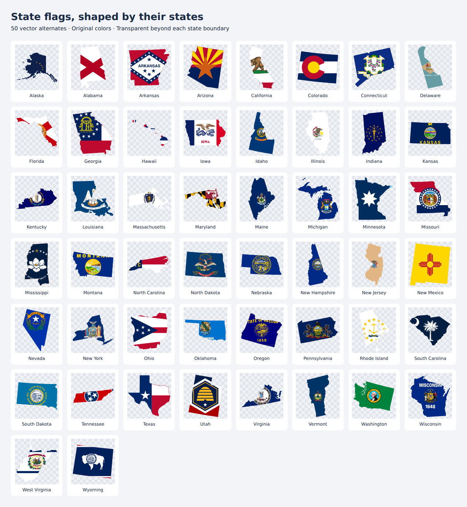
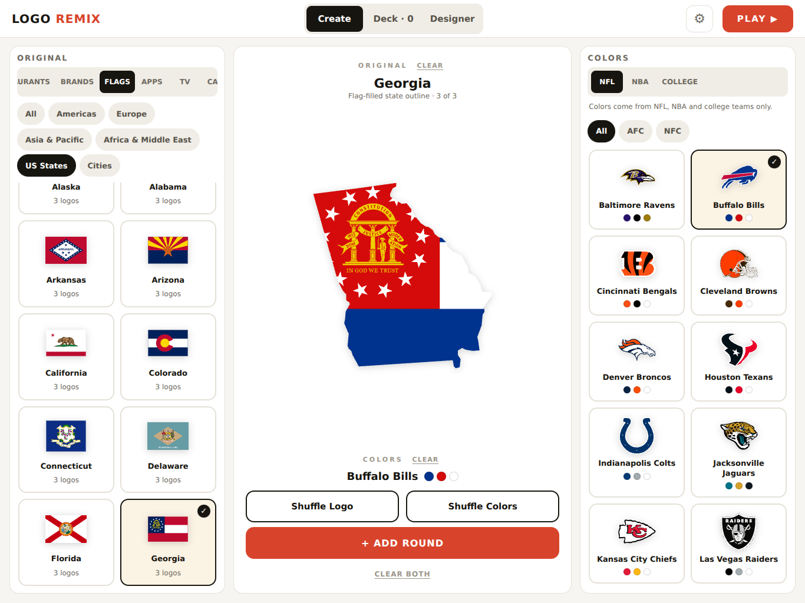
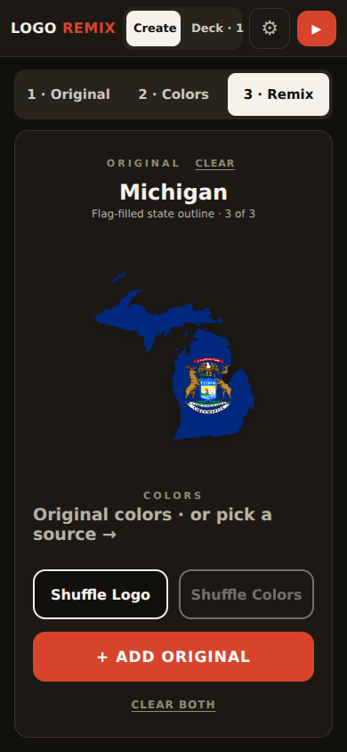

# State flag outline alternates

All 50 US states now offer a flag-filled outline through **Shuffle Logo**. The 49 new compositions use the existing flag artwork and exact silhouette geometry; Texas keeps its existing alternate. Original flags, silhouette alternates and Oregon's reverse stay available.

## Browser verification

- Chromium: desktop 1366 × 1024 in light mode and phone 390 × 844 in dark mode; no page errors or phone horizontal overflow.
- Selected Georgia's new alternate, remixed it with Buffalo Bills colors, added a round and confirmed `flag-map` survived reload.
- Exported original and remixed SVGs and 1024 px PNGs for Alaska, Hawaii, Michigan, Georgia, Nevada, Minnesota, Rhode Island, Ohio and Texas: 18 successful export pairs, no raster wrappers, live text or unresolved XML.
- Compared the rendered alpha of all 49 new alternates with their silhouettes at 256 px. Zero painted pixels outside a fully transparent silhouette (alpha > 8); zero missing opaque interior pixels (silhouette alpha > 240, flag alpha < 230). Edge antialiasing is excluded. See `coverage.json` and `browser-checks.json`.
- Reviewed the full contact sheet, including island groups, both Michigan peninsulas, narrow states and light flag fields.

## Automated coverage

`tests/state-flag-maps.test.ts` verifies all 50 alternates are reachable and survive saved-round normalization, reproduces all 49 generated assets offline, checks exact silhouette paths and internal SVG references, and rejects altered or unrelated inputs. The existing flag, brand, palette and export suites also cover the new catalog entries.

`npx bun test --timeout 60000`: 228 passed, 1 optional Potrace test skipped, 0 failed after integrating the latest main branch. The production build passes. Its existing bundle-size advisory remains unchanged. The optional Potrace test requires a separately installed binary.
