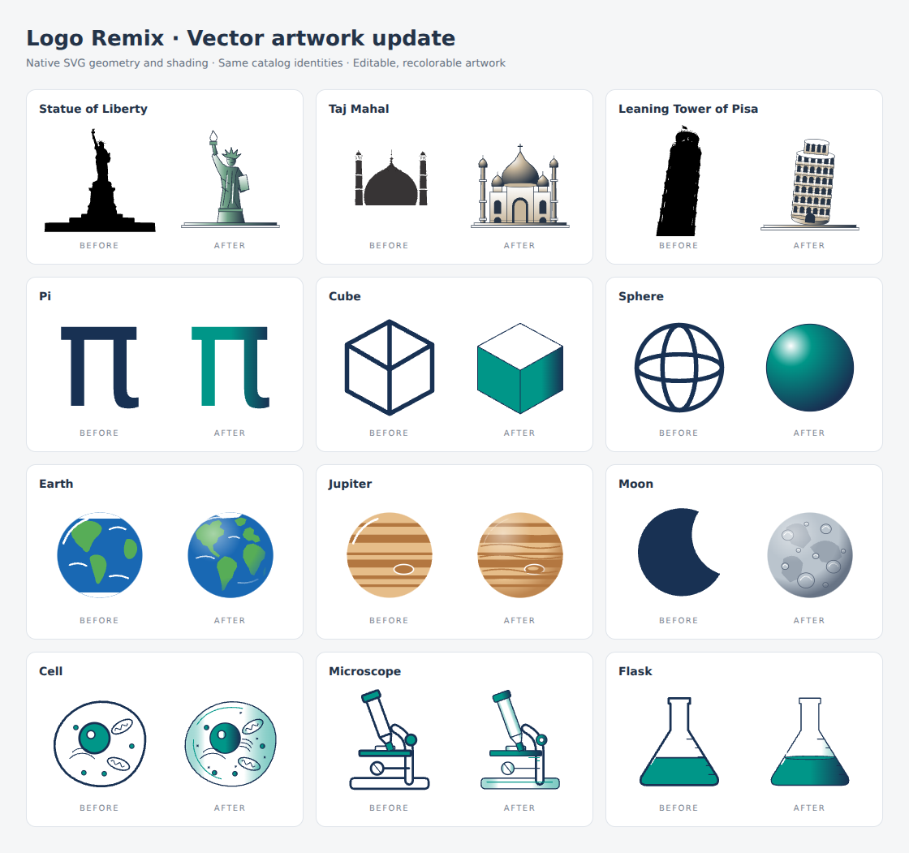
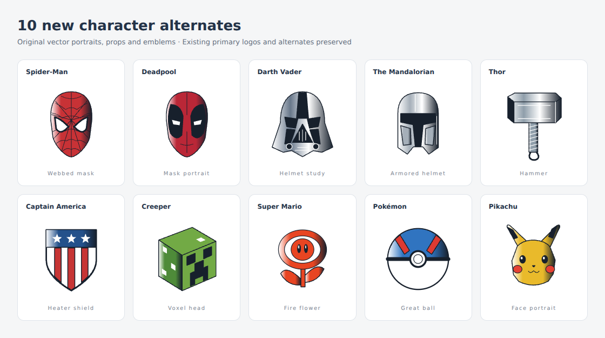

# SVG fidelity update

The update replaces 81 primary SVGs and adds 10 character alternates. Catalog IDs, the 40-landmark roster, the 115-character roster, existing alternate IDs, and saved-round formats are unchanged.

| Collection | Updated artwork |
| --- | --- |
| Landmarks | 16 architectural studies with arcades, cables, towers, setbacks, masonry, crown/robe details and material shading; 24 imported illustrations retained |
| Math | 22 outlined symbols with refined typography and two-color vector shading; lowercase pi keeps its familiar curved form |
| Shapes | 14 filled plane figures and 6 solid 3D forms; existing outline alternates retained |
| Space | All 13 entries: surface features, planet lighting, ring occlusion, full Moon and Sun, comet and galaxy |
| Science | All 10 entries: fine outlines, glass/liquid shading, menisci, cell details and mechanical parts |
| Characters | 10 new name-free portraits and props; existing marks and wordmark flags retained |

These are stylized vector illustrations, not measured elevations or scientific surface maps. See `public/logos/svg/education-SOURCES.md` for provenance and rebuild instructions. The new character studies are original drawings, not official logo files.

## Visual evidence

Application captures: [landmarks](landmarks-desktop.png), [math](math-desktop.png), [shapes](shapes-desktop.png), [space](space-desktop.png), [science](science-desktop.png), [characters](characters-desktop.png), [phone dark](phone-dark.png), [iPad portrait](ipad-light.png).

## Validation

- `npx bun test`: 220 passed, 1 skipped, 0 failed (221 tests across 26 files). The optional Potrace test is skipped because the Python Potrace dependency is absent. After the final pi glyph refinement, the education and vector-study suites were rerun: 8 passed.
- `npm run build`: passed. Vite reports the existing bundle-size advisory.
- All education SVGs rebuild byte-for-byte offline. Original landmark/character sources reproduce their imported output, and stale generated-source checksums are rejected.
- Source validation checks vectors, unique IDs, local gradient references, checksums, palette coverage, absence of images/live text/filters and stable saved alternate identity.
- Chromium: selected all six collections, remixed with Buffalo colors, cycled Spider-Man to the new webbed mask, added it to the deck, and verified it survived reload.
- Twelve original/remixed designs exported through the application's export implementation to both standalone SVG and 1024px PNG, then decoded in Chromium. See [browser-checks.json](browser-checks.json).
- Desktop 1366×1024, phone 390×844 dark, iPad 820×1180 light: no page errors or horizontal page overflow. Screenshots use reduced motion so artwork is captured after entry animations rather than partway through a fade.
